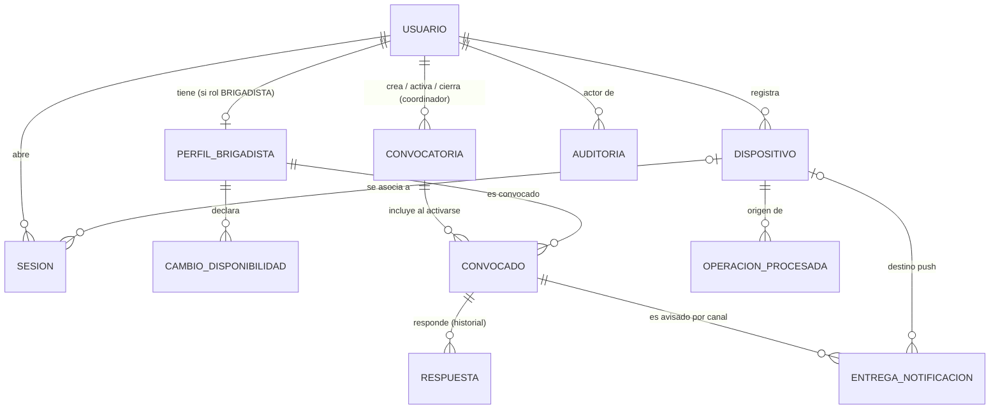

# Modelo conceptual

> **Estado: PROPUESTA PRELIMINAR — pendiente de aprobación.** Sin implementación.

## 1. Entidades del MVP

| Entidad                          | Qué representa                                                                              | Dueño (quién la escribe)                                     | Vive en                                                |
| -------------------------------- | ------------------------------------------------------------------------------------------- | ------------------------------------------------------------ | ------------------------------------------------------ |
| **Usuario**                      | Cuenta de acceso: RUT, credencial, rol, activo                                              | Administrador / coordinador vía servidor                     | Servidor                                               |
| **Perfil de brigadista**         | Datos operativos del brigadista y su disponibilidad actual                                  | Brigadista (disponibilidad); coordinador (datos de contacto) | Servidor + réplica propia en el teléfono               |
| **Cambio de disponibilidad**     | Cada vez que el brigadista declara su estado (append-only)                                  | Brigadista                                                   | Se origina en el teléfono, se consolida en el servidor |
| **Convocatoria**                 | Emergencia con su ciclo de vida: borrador → activa → cerrada                                | Coordinador (en línea)                                       | Servidor + réplica de lectura en el teléfono           |
| **Convocado**                    | Un brigadista incluido en una convocatoria al activarla (snapshot), con su respuesta actual | Servidor (alta); brigadista (respuesta)                      | Servidor + réplica propia                              |
| **Respuesta**                    | Cada respuesta `VOY` / `NO_PUEDO` enviada (append-only)                                     | Brigadista                                                   | Se origina en el teléfono                              |
| **Entrega de notificación**      | Estado del aviso de una convocatoria a un convocado por un canal                            | Servidor (envío, recibos); teléfono (acuse)                  | Servidor                                               |
| **Dispositivo**                  | Teléfono registrado de un usuario, con su token push                                        | Teléfono vía servidor                                        | Servidor + identidad local                             |
| **Sesión**                       | Token de renovación revocable ligado a un dispositivo o navegador                           | Servidor                                                     | Servidor                                               |
| **Recuperación de contraseña**   | Token o reinicio de contraseña de un solo uso                                               | Servidor                                                     | Servidor                                               |
| **Auditoría**                    | Acciones administrativas y de seguridad (append-only)                                       | Servidor                                                     | Servidor                                               |
| **Operación procesada**          | Registro de idempotencia de operaciones llegadas desde teléfonos                            | Servidor                                                     | Servidor                                               |
| **Operación pendiente (outbox)** | Cola local de cambios aún no confirmados por el servidor                                    | Teléfono                                                     | Solo teléfono                                          |

Fuera del MVP (documentadas como extensión, sin modelar): ubicaciones y
coordenadas, mensajería, radios Baofeng, nodos LoRa/Meshtastic, dispositivos
Bluetooth externos, múltiples brigadas.

## 2. Relaciones

Cardinalidades clave:

- Usuario 1 — 0..1 Perfil de brigadista (solo rol `BRIGADISTA` en el MVP; ver Q1).
- Convocatoria 1 — 0..N Convocados; un brigadista aparece **una sola vez** por convocatoria.
- Convocado 1 — 0..N Respuestas; la última define la respuesta actual.
- Convocado 1 — 0..N Entregas (una por canal: push, bandeja interna).
- Usuario 1 — 0..N Dispositivos (cambio de teléfono, reinstalación).

## 3. Reglas de negocio reflejadas en el modelo

| Regla                                  | Cómo la soporta el modelo                                                                                   |
| -------------------------------------- | ----------------------------------------------------------------------------------------------------------- |
| RN-01 una brigada                      | No existe entidad Brigada. Agregarla después implica una columna `brigade_id` en las entidades raíz         |
| RN-02 / RN-03 disponibilidad y 4 horas | Perfil guarda estado actual y fecha de última declaración; "desactualizado" se **calcula**, nunca se guarda |
| RN-04 disponibilidad ≠ respuesta       | Entidades separadas: Cambio de disponibilidad y Respuesta                                                   |
| RN-05 una convocatoria activa          | Restricción de unicidad sobre el estado `ACTIVA`                                                            |
| RN-06 notificar a todos los activos    | Al activar se crea un Convocado por cada brigadista con cuenta activa, sin mirar la disponibilidad          |
| RN-07 desactivados no reciben          | El snapshot excluye usuarios inactivos al momento de activar                                                |
| RN-08 `VOY` / `NO_PUEDO`               | Dominio cerrado de la Respuesta; "pendiente" = convocado sin respuesta                                      |
| RN-09 `VOY` ≠ `EN_SERVICIO`            | La Respuesta no modifica el Perfil                                                                          |
| RN-10 trazabilidad                     | Eventos append-only (disponibilidad, respuestas), timestamps de convocatoria y Auditoría                    |
| Entrega ≠ respuesta                    | Entrega de notificación con estados propios; el acuse del teléfono es un hecho distinto de la respuesta     |

## 4. Propiedad de los datos y dirección de sincronización

| Dato                                | Se crea en | Fuente de verdad        | Dirección                          |
| ----------------------------------- | ---------- | ----------------------- | ---------------------------------- |
| Cambio de disponibilidad            | Teléfono   | Servidor tras aceptarlo | Teléfono → servidor → teléfono     |
| Respuesta                           | Teléfono   | Servidor tras aceptarlo | Teléfono → servidor → teléfono     |
| Acuse de recepción                  | Teléfono   | Servidor                | Teléfono → servidor                |
| Convocatoria, Convocado             | Servidor   | Servidor                | Servidor → teléfono (solo lectura) |
| Perfil (datos de contacto)          | Servidor   | Servidor                | Servidor → teléfono                |
| Usuario, Sesión, Auditoría, Entrega | Servidor   | Servidor                | No se replican                     |

El teléfono **solo** guarda datos del propio brigadista y las convocatorias en
que fue incluido. No guarda la nómina de la brigada.

## 5. Clasificación de la información

| Nivel     | Datos                                                   | Tratamiento                                                                                                       |
| --------- | ------------------------------------------------------- | ----------------------------------------------------------------------------------------------------------------- |
| Secreto   | Hash de contraseña, tokens de renovación y recuperación | Solo servidor, guardados como hash; nunca en logs ni en el teléfono (tokens propios en SecureStore, no en SQLite) |
| Personal  | RUT, nombre, teléfono, correo                           | Servidor; en el teléfono solo nombre propio; RUT enmascarado en logs y auditoría                                  |
| Operativo | Disponibilidad, respuestas, convocatorias               | Servidor y réplica propia                                                                                         |
| Técnico   | Dispositivo, token push, operaciones procesadas         | Servidor; token push sin datos personales                                                                         |
