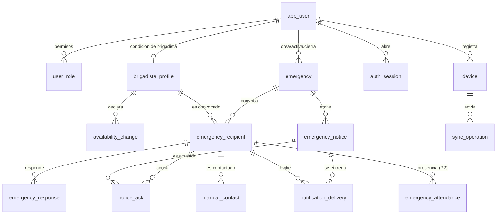

# Modelo físico — visión general

> **Estado: PROPUESTA PARA REVISIÓN.** Define tablas, relaciones, restricciones,
> índices y mecanismos de sincronización. **No** hay migraciones ni
> `schema.prisma`: el usuario los autoriza después de revisar este documento.
>
> Prevalece sobre `conceptual-model.md`, `logical-model.md` y
> `failure-scenarios.md` donde haya diferencias.

## Documentos

| Documento                                                                        | Contenido                                                           |
| -------------------------------------------------------------------------------- | ------------------------------------------------------------------- |
| [postgresql/schema.md](postgresql/schema.md)                                     | DDL de referencia del servidor                                      |
| [sqlite/schema.md](sqlite/schema.md)                                             | DDL de referencia del teléfono                                      |
| [synchronization/conflict-resolution.md](synchronization/conflict-resolution.md) | Tiempo, orden y conflictos sin depender solo del reloj del teléfono |
| [synchronization/offline-storage.md](synchronization/offline-storage.md)         | Cola local, operaciones rechazadas, limpieza y recuperación         |
| [synchronization/strategy.md](synchronization/strategy.md)                       | Flujo general de envío y recepción                                  |

El DDL está escrito para revisión. Al aprobarse, backend-architect lo traduce a
`schema.prisma` + SQL manual de Prisma Migrate, y mobile-architect a las
migraciones de la app.

## 1. Decisiones aplicadas

| #   | Decisión                                                                                                                                               | Fuente                                      | Cómo queda en el modelo                                                                                                                                                                           |
| --- | ------------------------------------------------------------------------------------------------------------------------------------------------------ | ------------------------------------------- | ------------------------------------------------------------------------------------------------------------------------------------------------------------------------------------------------- |
| Q1  | Un coordinador también puede ser brigadista. Permisos y condición de brigadista son independientes                                                     | Usuario                                     | `user_role` (solo `ADMINISTRADOR`, `COORDINADOR`, varios por usuario) **separado** de `brigadista_profile` (con su propio `active`). Convocados = cuenta activa **y** perfil de brigadista activo |
| Q2  | Reconfirmar cuenta como actualización                                                                                                                  | Usuario                                     | Cada declaración es una fila en `availability_change`, aunque repita el estado                                                                                                                    |
| Q3  | Aceptar respuestas hechas antes del cierre aunque lleguen después, conservando fecha declarada y de recepción e identificando la sincronización tardía | Usuario                                     | `declared_at`, `estimated_at`, `received_at` y `late_sync_after_close` en `emergency_response`                                                                                                    |
| Q4  | Cambiar la respuesta mientras está activa, con historial                                                                                               | Usuario                                     | `emergency_response` append-only + respuesta vigente en `emergency_recipient`                                                                                                                     |
| Q5  | Tipo de emergencia como texto libre                                                                                                                    | Usuario                                     | `emergency.emergency_type text`                                                                                                                                                                   |
| Q6  | Restablecimiento iniciado por un administrador, con cambio obligatorio                                                                                 | Usuario                                     | El administrador fija una contraseña provisoria: `must_change_password = true`, `password_expires_at`, revocación de sesiones y auditoría. Sin tabla de tokens de recuperación                    |
| Q7  | `America/Santiago`                                                                                                                                     | Usuario                                     | Todo en UTC; la zona se aplica al presentar                                                                                                                                                       |
| Q8  | Sin eliminación de historial en el MVP                                                                                                                 | Usuario                                     | FK con `ON DELETE RESTRICT`; tablas de historial append-only por trigger                                                                                                                          |
| Q9  | 30 días de convocatorias cerradas en el teléfono, salvo activas y con operaciones pendientes                                                           | Usuario                                     | Limpieza local protegida por FK y triggers (ver `sqlite/schema.md` §4)                                                                                                                            |
| P1  | Una sola convocatoria activa                                                                                                                           | **Supuesto** (recomendación, sin respuesta) | Índice único parcial; el segundo foco se comunica como aviso `UPDATE`                                                                                                                             |
| P2  | Control de presencia en terreno                                                                                                                        | **Supuesto: incluido como condicional**     | Tabla `emergency_attendance` marcada; se elimina del diseño si se rechaza                                                                                                                         |
| P3  | Sin SMS en el MVP                                                                                                                                      | **Supuesto**                                | `delivery_channel` solo `PUSH`, extensible                                                                                                                                                        |
| P4  | Dos o más coordinadores                                                                                                                                | **Supuesto**                                | Sin efecto en el modelo; recomendación operativa                                                                                                                                                  |

## 2. Los seis puntos de la revisión

| Punto                                                    | Dónde se resuelve                                                                                                                                                                                                                                            |
| -------------------------------------------------------- | ------------------------------------------------------------------------------------------------------------------------------------------------------------------------------------------------------------------------------------------------------------ |
| 1. Cola de sincronización persistente en SQLite          | `outbox` en la misma transacción que el dato; `journal_mode = WAL`, `synchronous = FULL`; número de secuencia por dispositivo asignado en esa transacción                                                                                                    |
| 2. Protección contra duplicados al reenviar              | `operation_id` (UUID) como PK en `outbox` y en `sync_operation`; además U (`device_id`, `device_seq`); los registros creados usan el mismo UUID; acuses con U (`notice_id`, `recipient_id`, `device_id`)                                                     |
| 3. Conflictos sin depender solo del reloj                | Orden por `device_seq` dentro de un dispositivo; reloj monotónico y desfase medido para estimar la hora real; `base_row_version` para detectar escrituras sobre datos desactualizados; ventana de ambigüedad que marca `CONFLICT` en vez de decidir a ciegas |
| 4. Conservación de operaciones rechazadas                | Servidor: `sync_operation` guarda payload, motivo y estado de resolución, sin borrar. Teléfono: `outbox` mantiene `REJECTED` hasta que el usuario lo ve, y luego 30 días más                                                                                 |
| 5. Permisos separados de la condición de brigadista      | `user_role` vs `brigadista_profile.active`                                                                                                                                                                                                                   |
| 6. Limpieza local que no toque lo activo ni lo pendiente | FK `RESTRICT` de `outbox` a `emergency`; triggers que abortan el borrado de convocatorias activas y de filas no sincronizadas                                                                                                                                |

## 3. Tablas

### Servidor (PostgreSQL)

| Tabla                       | Tipo                         | Replicada al teléfono                                     |
| --------------------------- | ---------------------------- | --------------------------------------------------------- |
| `app_user`                  | Mutable                      | Solo nombre y estado propios                              |
| `user_role`                 | Mutable                      | Solo los propios                                          |
| `brigadista_profile`        | Mutable                      | El propio                                                 |
| `availability_change`       | Append-only                  | La propia (30 días)                                       |
| `emergency`                 | Mutable                      | Si el usuario fue convocado; activas y cerradas ≤ 30 días |
| `emergency_notice`          | Append-only                  | Las de sus convocatorias                                  |
| `emergency_recipient`       | Mutable                      | Las propias                                               |
| `emergency_response`        | Append-only                  | Las propias                                               |
| `notice_ack`                | Append-only                  | No (el teléfono guarda su copia local)                    |
| `notification_delivery`     | Mutable                      | No                                                        |
| `manual_contact`            | Append-only                  | No                                                        |
| `emergency_attendance` (P2) | Append-only                  | No                                                        |
| `device`                    | Mutable                      | No                                                        |
| `auth_session`              | Mutable                      | No                                                        |
| `sync_operation`            | Append-only salvo resolución | No                                                        |
| `sync_metadata`             | Una fila                     | Época incluida en cada respuesta                          |
| `audit_log`                 | Append-only                  | No                                                        |

### Teléfono (SQLite)

`device_identity`, `local_user`, `brigadista_profile`, `availability_change`,
`emergency`, `emergency_notice`, `emergency_recipient`, `emergency_response`,
`notice_ack`, `outbox`, `sync_state`.

## 4. Relaciones principales

## 5. Mecanismos transversales

| Mecanismo       | Implementación (servidor)                                                                                                                                                                 |
| --------------- | ----------------------------------------------------------------------------------------------------------------------------------------------------------------------------------------- |
| IDs             | `uuid` con `DEFAULT uuidv7()` (nativo en PostgreSQL 18); el teléfono envía sus propios UUID v7                                                                                            |
| Versión de fila | Secuencia global `sync_row_version_seq` asignada por trigger, con un candado de transacción que garantiza que las versiones se confirman en orden (sin huecos visibles para los cursores) |
| Append-only     | Trigger que rechaza `UPDATE`/`DELETE` + el rol de la aplicación sin esos permisos                                                                                                         |
| Borrados        | Sin borrado físico en el MVP; solo `emergency` en `DRAFT` admite `deleted_at`                                                                                                             |
| Época           | `sync_metadata.sync_epoch` cambia al restaurar un backup                                                                                                                                  |

## 6. Compatibilidad con Prisma

| Elemento                                                          | Prisma                                  | SQL manual en la migración |
| ----------------------------------------------------------------- | --------------------------------------- | -------------------------- |
| Tablas, columnas, enums, FK, únicos compuestos, `jsonb`, `BigInt` | Sí                                      | —                          |
| `DEFAULT uuidv7()`                                                | `@default(dbgenerated("uuidv7()"))`     | —                          |
| Relación circular `emergency_recipient` ↔ `emergency_response`    | Sí, con relaciones con nombre           | —                          |
| Índices únicos parciales                                          | Verificar soporte en la versión elegida | Si no lo soporta           |
| Restricciones `CHECK`                                             | No                                      | Sí                         |
| Triggers (versión de fila, append-only) y secuencia               | No                                      | Sí                         |
| Permisos del rol de la aplicación                                 | No                                      | Sí (o script de devops)    |

Versión de PostgreSQL: **18** (por `uuidv7()`). Si se usa una anterior, el UUID
se genera en el backend y se quita el `DEFAULT`. Lo fija devops-architect.

## 7. Pendiente después de esta revisión

- Aprobación de P1–P4.
- Autorización para traducir a `schema.prisma` y migraciones.
- Contrato HTTP de sincronización (backend-architect + mobile-architect) sobre
  `conflict-resolution.md` y `offline-storage.md`.
