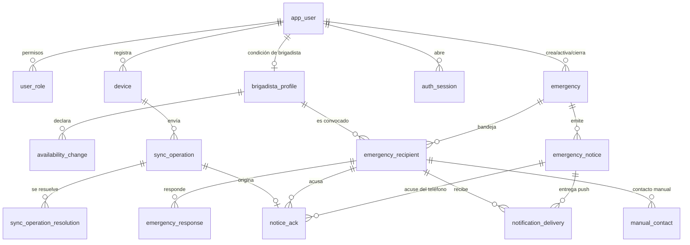

# Modelo físico — visión general (revisión 2.1)

> **Estado: revisión 2.1, tras implementar.** Arquitectura aprobada por el
> usuario (2026-11-13). backend-architect tradujo la revisión 2 a
> `backend/prisma/schema.prisma` y dos migraciones, aplicadas **solo en la base
> local de Docker** (PostgreSQL 18.7); la auditoría de database-architect la
> encontró fiel. La revisión 2.1 incorpora los ajustes de esa auditoría sin
> cambiar decisiones aprobadas.
>
> Prevalece sobre `conceptual-model.md`, `logical-model.md` y
> `failure-scenarios.md` donde haya diferencias. Cambios y verificación:
> [review-checklist.md](review-checklist.md) (§1 revisión 2, §5 revisión 2.1).

## Documentos

| Documento                                                                        | Contenido                                                       |
| -------------------------------------------------------------------------------- | --------------------------------------------------------------- |
| [postgresql/schema.md](postgresql/schema.md)                                     | DDL de referencia del servidor (17 tablas)                      |
| [sqlite/schema.md](sqlite/schema.md)                                             | DDL de referencia del teléfono (11 tablas)                      |
| [synchronization/versioning.md](synchronization/versioning.md)                   | Demostración del orden de `row_version` y protocolo de descarga |
| [synchronization/conflict-resolution.md](synchronization/conflict-resolution.md) | Tiempo, orden y conflictos sin depender solo del reloj          |
| [synchronization/offline-storage.md](synchronization/offline-storage.md)         | Cola local, rechazos, limpieza y recuperación                   |
| [synchronization/delivery-and-ack.md](synchronization/delivery-and-ack.md)       | Bandeja, entrega push y acuse como hechos separados             |
| [security.md](security.md)                                                       | Contraseñas provisorias, revocación de sesiones, clasificación  |
| [synchronization/strategy.md](synchronization/strategy.md)                       | Flujo general de envío y recepción                              |

## 1. Decisiones aplicadas

| #      | Decisión                                                  | Cómo queda en el modelo                                                                             |
| ------ | --------------------------------------------------------- | --------------------------------------------------------------------------------------------------- |
| Q1     | Coordinador también puede ser brigadista                  | `user_role` separado de `brigadista_profile.active`. Convocados = cuenta activa y perfil activo     |
| Q2     | Reconfirmar cuenta como actualización                     | Cada declaración es una fila en `availability_change`                                               |
| Q3     | Aceptar respuestas previas al cierre que llegan después   | `declared_at`, `estimated_at`, `received_at`, `late_sync_after_close`                               |
| Q4     | Cambiar la respuesta con historial                        | `emergency_response` append-only + vigente en `emergency_recipient`                                 |
| Q5     | Tipo de emergencia como texto libre                       | `emergency.emergency_type text`                                                                     |
| Q6     | Restablecimiento por administrador con cambio obligatorio | Contraseña provisoria con vencimiento, sesión restringida, `credential_version` (ver `security.md`) |
| Q7     | `America/Santiago`                                        | Todo en UTC; la zona se aplica al presentar                                                         |
| Q8     | Sin eliminación de historial                              | `ON DELETE RESTRICT`, triggers append-only, sin `DELETE` para la app                                |
| Q9     | 30 días en el teléfono, salvo activas y pendientes        | Limpieza protegida por FK y triggers                                                                |
| **P1** | **Una sola convocatoria activa** — aprobado               | Índice único parcial                                                                                |
| **P2** | **Sin control de presencia en el MVP** — aprobado         | `emergency_attendance` retirada                                                                     |
| **P3** | **Sin SMS** — aprobado                                    | `delivery_channel` solo `PUSH`, extensible                                                          |
| **P4** | **Varios coordinadores** — aprobado                       | Sin efecto en el modelo (`user_role` ya lo permite)                                                 |

## 2. Puntos de la revisión 2

| Punto                                                            | Respuesta                                                                                                                                                                                                                                                                | Documento                                        |
| ---------------------------------------------------------------- | ------------------------------------------------------------------------------------------------------------------------------------------------------------------------------------------------------------------------------------------------------------------------ | ------------------------------------------------ |
| 1. Orden de confirmación y descargas consistentes                | Candado de transacción + secuencia `CACHE 1`; demostración formal; descarga en una instantánea `REPEATABLE READ`; upsert solo si la versión es mayor; caso del convocado tardío                                                                                          | `versioning.md`                                  |
| 2. Operaciones originales inmutables y resoluciones como eventos | `sync_operation` append-only; nueva `sync_operation_resolution` (append-only, una resolución final por operación); correcciones como respuestas nuevas con `corrects_operation_id`; en el teléfono, triggers que impiden cambiar el contenido de operaciones y registros | `postgresql/schema.md` §7, `sqlite/schema.md` §3 |
| 3. Contraseñas provisorias y revocación                          | `CHECK` provisoria ⇔ vencimiento; `credential_version`; `session_scope`; rotación con `family_id` y detección de reutilización; candado de fila contra la carrera renovación/restablecimiento                                                                            | `security.md`                                    |
| 4. Bandeja, entrega push y acuse separados                       | `notification_delivery` solo con hechos del proveedor; `notice_ack` solo del teléfono, ligado a su operación, con nivel y vía; bandeja independiente del push                                                                                                            | `delivery-and-ack.md`                            |

Los seis puntos de la revisión 1 siguen cubiertos (ver `review-checklist.md`).

## 3. Tablas

### Servidor (PostgreSQL) — 17

| Tabla                       | Tipo                    | Replicada al teléfono                                     |
| --------------------------- | ----------------------- | --------------------------------------------------------- |
| `app_user`                  | Mutable                 | Solo nombre, estado y roles propios                       |
| `user_role`                 | Mutable (alta/baja)     | Vía `app_user`                                            |
| `brigadista_profile`        | Mutable                 | El propio                                                 |
| `availability_change`       | Append-only             | La propia (30 días)                                       |
| `emergency`                 | Mutable                 | Si el usuario fue convocado; activas y cerradas ≤ 30 días |
| `emergency_notice`          | Append-only             | Las de sus convocatorias                                  |
| `emergency_recipient`       | Mutable                 | Las propias                                               |
| `emergency_response`        | Append-only             | Las propias                                               |
| `notice_ack`                | Append-only             | No (copia local propia)                                   |
| `notification_delivery`     | Mutable                 | No                                                        |
| `manual_contact`            | Append-only             | No                                                        |
| `device`                    | Mutable                 | No                                                        |
| `auth_session`              | Mutable                 | No                                                        |
| `sync_operation`            | **Append-only**         | No                                                        |
| `sync_operation_resolution` | **Append-only** (nueva) | No                                                        |
| `sync_metadata`             | Una fila                | Época incluida en cada respuesta                          |
| `audit_log`                 | Append-only             | No                                                        |

`emergency_attendance` se retiró (P2).

### Teléfono (SQLite) — 11

`device_identity`, `local_user`, `brigadista_profile`, `availability_change`,
`emergency`, `emergency_notice`, `emergency_recipient`, `emergency_response`,
`notice_ack`, `outbox`, `sync_state`.

## 4. Relaciones principales

## 5. Mecanismos transversales

| Mecanismo       | Implementación (servidor)                                                    |
| --------------- | ---------------------------------------------------------------------------- |
| IDs             | `uuid DEFAULT uuidv7()` (PostgreSQL 18); el teléfono envía sus UUID v7       |
| Versión de fila | Secuencia `CACHE 1` + candado de transacción (`versioning.md`)               |
| Append-only     | Trigger que rechaza `UPDATE`/`DELETE` + permisos del rol                     |
| Borrados        | Solo `user_role` (con touch de `app_user`) y `emergency` en `DRAFT` (lógico) |
| Época           | `sync_metadata.sync_epoch` cambia al restaurar un backup                     |
| Credenciales    | `credential_version` invalida sesiones al restablecer o desactivar           |

## 6. Compatibilidad con Prisma

| Elemento                                                                                                           | Prisma                                                                       | SQL manual en la migración             |
| ------------------------------------------------------------------------------------------------------------------ | ---------------------------------------------------------------------------- | -------------------------------------- |
| Tablas, columnas, enums, FK, únicos compuestos, `jsonb`, `BigInt`                                                  | Sí                                                                           | —                                      |
| `DEFAULT uuidv7()`                                                                                                 | `@default(dbgenerated("uuidv7()"))`                                          | —                                      |
| Relaciones circulares (`emergency_recipient` ↔ `emergency_response`, `brigadista_profile` ↔ `availability_change`) | Sí, con relaciones con nombre                                                | —                                      |
| Índices parciales (9, únicos o no)                                                                                 | No se declaran (sin preview `partialIndexes`); Prisma los ignora al comparar | Sí, solo SQL de la migración           |
| Correo único sin distinguir mayúsculas                                                                             | Único simple sobre `email`                                                   | `CHECK (email = lower(email))`         |
| Únicos de invariantes 1:1 (`last_availability_change_id`, `current_response_id`, `notice_ack.operation_id`)        | Sí (exigidos por relaciones 1:1)                                             | —                                      |
| `row_version`                                                                                                      | `@default(0)` solo para insertar                                             | Trigger + `CHECK (row_version > 0)`    |
| `updated_at`                                                                                                       | `@default(now())`, **sin** `@updatedAt`                                      | Trigger `touch_updated_at`             |
| `CHECK`, triggers, secuencia `CACHE 1`, candado                                                                    | No                                                                           | Sí                                     |
| Permisos del rol de la aplicación                                                                                  | No                                                                           | Script de devops-architect (pendiente) |

Versión usada: Prisma 7.10.1. Detalle de la implementación:
`backend/prisma/README.md`.

**Índices parciales.** Con el preview `partialIndexes`, Prisma comparaba el
texto del predicado y PostgreSQL lo guarda reescrito (`IN (...)` pasa a
`= ANY (ARRAY[...])`), así que cada `migrate diff` proponía borrarlos y
recrearlos. Sin el preview, Prisma no los declara ni los toca: existen solo en
el SQL de las migraciones (y como comentario en el modelo de `schema.prisma`).
Un índice parcial nuevo se agrega a mano en una migración nueva; database-architect
lo revisa en el SQL, no en `schema.prisma`.

**`updated_at`.** Lo pone siempre el servidor de base de datos (`DEFAULT now()`
y `touch_updated_at`). Sin `@updatedAt`, el reloj de la aplicación no interviene
y no hay dos fuentes para el mismo dato.

## 7. Fuera del alcance de esta misión

- `schema.prisma`, migraciones y su ejecución: los escribe y aplica
  backend-architect (database-architect diseña y revisa). Cualquier entorno
  distinto de la base local requiere autorización expresa.
- Contrato HTTP de sincronización: backend-architect + mobile-architect.
- Tiempos de re-aviso, vida del token de acceso y plazo de la contraseña
  provisoria: backend-architect (valores sugeridos en `security.md` y
  `delivery-and-ack.md`).
